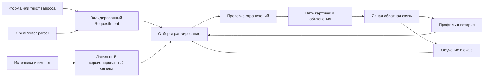
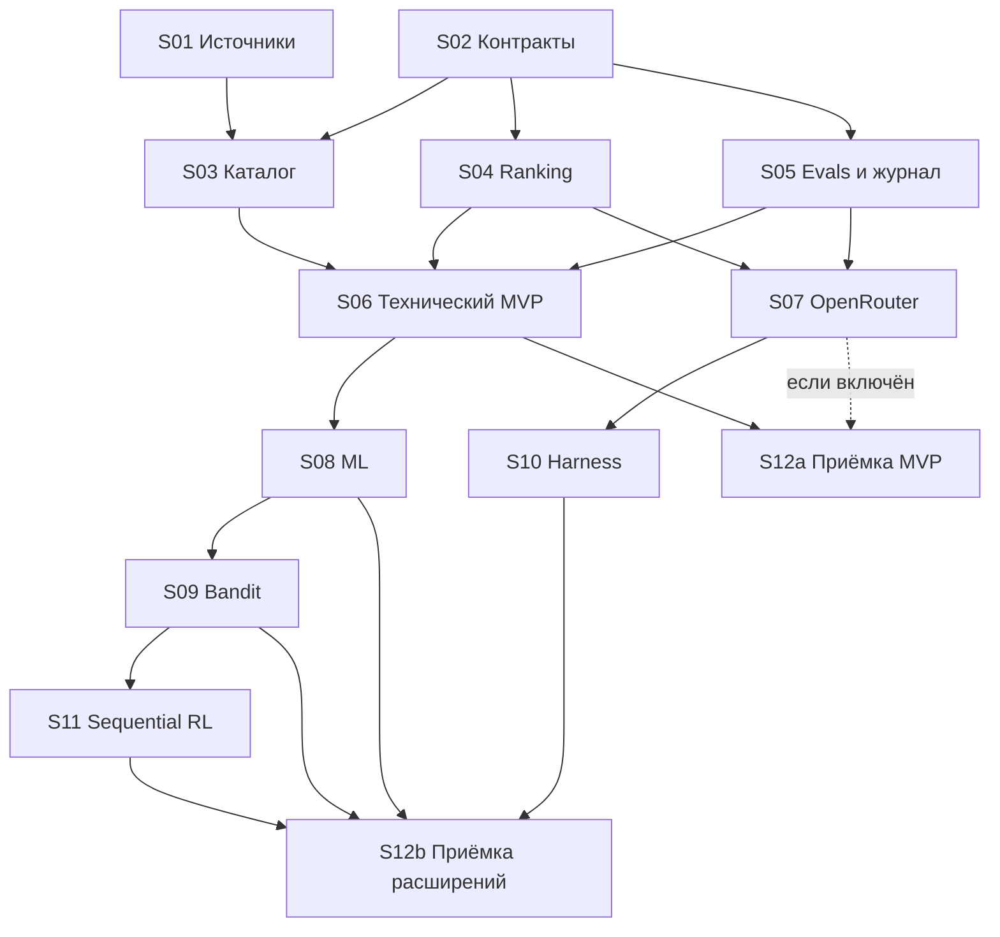

# План реализации Music Discovery

Версия: 0.4, 2026-10-28. Реализован технический прототип; текущие проверки и незакрытые критерии: [статус реализации](../docs/implementation-status.md). Продуктовый G0 остаётся limited.
Владелец реализации и интеграции: Codex. Пользователь не должен вручную запускать ECC-команды или писать код этапов.

## 1. Результат и границы

Приложение предлагает пять музыкальных релизов в выбранном жанре с объяснением соответствия вкусу, степени новизны и известности. Система и ML-модель многожанровые; хип-хоп — первый набор данных для обучения и проверки. Если валидных кандидатов меньше, возвращает меньше и объясняет причину. Пользователь выбирает жанр и режим, затем оставляет обратную связь после прослушивания.

Приоритеты: полезный поиск → достоверные данные → измеримое качество → ML-персонализация → управляемое исследование → bounded LLM agent → последовательный RL.

Первый охват: альбомы, EP и микстейпы; один локальный пользователь; ссылки на прослушивание, когда они есть в источнике. Воспроизведение, генерация аудио, анализ звука, социальная сеть и обучение LLM не входят в MVP. В одном запросе v0.1 выбирается один жанр; поджанр можно закрепить жёстко. Исследование остаётся внутри выбранной области: «удиви меня» не означает переход в другой жанр. Смешанные жанровые запросы можно добавить позже.

Жанры задаются версионированным справочником и конфигурацией, без `if genre == hip_hop` в ядре, UI или prompt. Первый обученный artifact может быть подтверждён только для hip-hop; другие жанры используют baseline до накопления своих данных. Многожанровая архитектура не означает доказанное обобщение модели, обученной на одном жанре.

Три уровня готовности различаются:

1. **Технический MVP:** приложение и тесты работают с локальным каталогом, в том числе при отсутствии источников рейтингов.
2. **Продуктовый MVP:** известность действительно измеряется, каталог покрывает разные направления; подтверждены реальные источники и provenance.
3. **Доказанная полезность:** личные прослушивания показывают результат относительно baseline. Успешные unit tests этого не доказывают.

## 2. Команда ECC и организация работы

Доступно четыре одновременно работающих агента: координатор и три исполнителя. Роли переиспользуются между волнами; все навыки загружаются по соответствующей задаче, а не весь каталог ECC сразу.

| Роль | Ответственность | Навыки ECC |
|---|---|---|
| Координатор | Контракты, DAG задач, интеграция, фиксация решений и статуса | blueprint, parallel-execution-optimizer |
| Data / Architecture | Источники, идентичность релизов, SQLite, data contracts | recsys-pipeline-architect, api-design |
| ML / RL | Признаки, ranking, обучение, эксперименты и политика | ml-adoption-playbook, mle-workflow |
| Harness / QA | OpenRouter, сценарии ошибок, evals, проверка секретов | agent-harness-construction, eval-harness, security-review |

Для каждой задачи один владелец записи. Ревью выполняет другой агент; при занятых слотах ревью идёт следующей волной. Контракты и миграции меняет только координатор после согласования зависимостей. Изменение одной и той же базы несколькими агентами запрещено; у тестов отдельные временные БД.

Сложность моделей агентов: текущая доступная модель для реализации, наиболее сильная доступная для архитектурного и adversarial review. Конкретные неподключённые модели и ECC slash-команды не считаются существующими механизмами выполнения. Используются реальные native subagents и прочитанные SKILL.md.

Работа сейчас локальная: существующего репозитория/remote нет, GitHub auth проверку не прошёл. Это не мешает плану. В S02 создаётся локальный git-репозиторий; публикация не входит в текущую задачу. До него write surfaces изолируются по файлам, после — независимые ветки/worktrees по необходимости.

## 3. Источники и первый контрольный пункт G0

RYM и AOTY остаются желаемыми адаптерами. Неофициальный wrapper не равен разрешённому API. Импорт файла также требует понятного происхождения и условий использования.

Подтверждено 2026-10-28:

- [AOTY Terms](https://www.albumoftheyear.org/terms-of-use/), §4/9, ограничивают систематический сбор и автоматический доступ; предлагают обратиться по поводу API/data partnership. Сборщик не включать без соответствующих условий доступа.
- RYM не удалось прочитать используемым браузером; API, экспорт и условия интеграции не подтверждены. Статус адаптера `unverified`, не `available`.
- [MusicBrainz API](https://musicbrainz.org/doc/MusicBrainz_API) — кандидат для идентификаторов, метаданных и жанров. Использовать cache, осмысленный User-Agent и не более одного запроса в секунду. Покрытие рейтингов/жанров и условия конкретных полей требуют проверки в S01.

Отдельно исследовать источник известности: разрешённые counts голосов или слушателей. Метаданные MusicBrainz не являются автоматической заменой RYM/AOTY popularity. Если подходящего источника нет, техническая разработка продолжается; продуктовый MVP «малоизвестное» остаётся незавершённым, UI пишет «известность неизвестна».

S01 должен дать реальную выборку, а не только ссылки на документацию. Продуктовые пороги первого hip-hop пилота (это требования, не полученные результаты): ≥300 уникальных релизов, ≥6 вручную проверенных семейств поджанров по ≥30 релизов; ≥95% записей пилотной выборки с подтверждённой принадлежностью hip-hop; ≥80% с пригодным датированным показателем известности. Эти проценты — покрытие пилотной выборки, не всего рынка и не будущего многожанрового каталога. Для следующего жанра задаётся отдельный coverage manifest и G0; пороги hip-hop не копируются автоматически.

Sample audit S01 даёт только предварительное решение. Полный G0 product pass возможен после S03 audit реального snapshot и выдаётся по genre scope. Отчёт содержит матрицу жанр × поджанр × источник × возрастная группа: coverage, размер сравнительной группы, свежесть, число релизов/исполнителей после strict rarity фильтра. Для каждой заявленной поддерживаемой группы нужны ≥80% пригодных observations и ≥10 разных исполнителей, проходящих strict rarity до персональных исключений. Непокрытые группы обозначаются limited; агрегированный процент не скрывает пропуски отдельного поджанра. Registry отдельно хранит catalog/popularity/personalization readiness каждого жанра.

Дополнительный кандидат для S01 — [Last.fm album.getInfo](https://www.last.fm/api/show/album.getInfo) с listeners/playcount. Требуется собственный API key и проверка [условий](https://www.last.fm/api/tos); это исследуемый вариант, не уже доступная интеграция.

Каталог набирается не только из top charts: фиксируются источники/страницы выборки, диапазоны лет, поджанры и перекосы. Иначе редкие релизы не попадут в кандидаты вообще. При недостатке покрытия расширять данные или честно ограничивать продукт, а не заполнять поля догадками LLM.

Если для источника нужно разрешение, подготовить описание требуемых полей и условий. Самостоятельно сообщения владельцам сервисов не отправлять. Независимые задачи не останавливаются.

## 4. Архитектура и контракты

Стек v0.1: Python, uv, SQLite, Streamlit, Pydantic, NumPy/scikit-learn, pytest, HTTP-клиент. Версии фиксируются при реализации в lockfile. Ноутбуки нужны для объяснения экспериментов, рабочая логика находится в Python-модулях.

Общий pipeline: Source → Hydrator → Filter → Scorer → Selector → SideEffect; схема из ECC recsys-pipeline-architect, популяризированная [xAI For You](https://github.com/xai-org/x-algorithm). Внешние источники обновляются отдельно; выдача не зависит от живого обхода сайтов.

Source собирает кандидатов из близких тегов, разных поджанров и мало представленных направлений. Hydrator добавляет локальные признаки. Filter убирает неверный жанр, известные релизы и дубликаты. Scorer независимо оценивает релизы. Selector учитывает режим и разнообразие всего набора. SideEffect отправляет аналитику асинхронно; критичные decision records сохраняются надёжно через локальный журнал/outbox до показа, чтобы не потерять основание обучения. При сбое журналирования bandit не используется; UI сообщает о проблеме сохранения.

Предлагаемые модули: `catalog/`, `contracts/`, `ranking/`, `feedback/`, `training/`, `experiments/`, `llm/`, `agent/`, `ui/`, `evals/`. Один процесс; отдельные сервисы без необходимости не вводятся.

### Сущности

| Сущность | Обязательные данные / правило |
|---|---|
| Artist | Внутренний ID, имя, внешние ID и aliases |
| ReleaseGroup | Канонический релиз, список artist IDs, название, тип, дата и её точность; editions не становятся новыми рекомендациями |
| SourceObservation | Source ID/URL, release mapping, observed_at, raw score/scale/count, raw tags, доступ/лицензия, snapshot ID; исходные значения не затираются |
| GenreRegistry | Стабильный genre_id, имя/aliases, parent edges, taxonomy_version, membership rules, capability status; жанр не зашит в enum кода |
| GenreAssertion | ReleaseGroup↔genre_id many-to-many, original value, источник, способ подтверждения; неизвестное отдельно; несколько родителей допустимы, циклы запрещены |
| UserProfile | Глобальное знакомство + anchors/preferences по genre scope; seed artists, likes/dislikes, `profile_basis=artist_prior|rated_releases|unavailable`, confidence, версии профиля |
| RequestIntent | `genre_scope_id` из registry (пилотный default hip-hop), locked subgenre IDs?, `mode=close|explore|surprise`, `obscurity=prefer|require`, rarity criterion version, count 1..5, exclusions, session preferences |
| Decision | request_id, timestamp, genre_scope_id/taxonomy version, catalog/profile/model/policy/feature versions, candidate IDs и features hash, выбранные позиции, scores, random seed, propensity где определена |
| Impression | decision_id, item_id, position, delivered_at/visible_at; повтор рендера UI не создаёт новый decision |
| Feedback | event_id, decision_id?, release_id, genre_scope контекста (или unknown для прямой оценки), event type, occurred_at, recorded_at/available_at, rating/context; idempotency key; исправления append-only |
| FamiliarityOutcome | decision_id, release_id, `familiar_before_recommendation=true|false|unknown`, answered_at; не меняет исторический профиль |
| Experiment | Зафиксированные cohorts/splits, configs, model artifact, metrics, размер выборки и статус данных |

Не сливать спорные совпадения по одному названию. MusicBrainz release-group ID предпочтителен, иначе conservatively match artist+title+type+date и отмечать ручную проверку. Ratings разных сайтов и их counts не суммировать. Отсутствующее значение — `null`, а не ноль.

Жанр не входит в identity релиза: crossover имеет один ID, несколько assertions, одну историю знакомства. Membership определяется подтверждённой принадлежностью scope или его потомкам в зафиксированной taxonomy; locked subgenres должны быть внутри scope. Неизвестный genre ID даёт явную ошибку, а не fallback в hip-hop. При нескольких подходящих ветках сравнительная группа выбирается детерминированным версионированным правилом до scoring, её ID сохраняется; выбирать группу постфактум ради более выгодной редкости нельзя. Добавление жанра меняет данные/config и при необходимости artifact, но не core-код.

## 5. Рекомендации и обучение

### Холодный старт и режимы

Любимые исполнители пользователя — исходные слабые предпочтения hip-hop пилота, не положительные метки для всех их альбомов. Seed IDs: Death Grips, Kendrick Lamar, Denzel Curry, JPEGMAFIA, Kanye West; сопоставляются с каталогом и хранятся в pilot config. До likes создаются отдельные weak-prior anchors по проверенным тегам каждого артиста/его доступных релизов внутри выбранной жанровой области с нормированием вклада по артисту. Это prior пользователя, а не перенос жанра исполнителя на каждый релиз. Несколько anchors сохраняют разные направления вкуса вместо одного усреднённого вектора.

`profile_basis=artist_prior` и низкая confidence видны в диагностике; после реальных отзывов prior ослабляется. Если seeds/теги в выбранном жанре отсутствуют, `profile_basis=unavailable`: разнообразная неперсонализированная выдача этого жанра, без вычисления расстояния от пустого вектора и обещаний сходства. Режимы тогда управляют широтой покрытия его поджанров. Seed albums можно выбрать позже. История хип-хопа не становится автоматически профилем джаза или металла.

«Не люблю коммерческий рэп» не превращать в фильтр по известности. R&B-кроссовер — мягкое предпочтение в hip-hop контексте; оно не запрещает выбрать R&B как самостоятельный жанр. У preferences есть `scope=genre|global|session`; глобальный перенос требует явного выбора пользователя. Жёсткий запрет появляется только по явному запросу.

Разделять:

- **Familiarity:** знает ли пользователь релиз/исполнителя. Отсутствие в истории означает «неизвестно», а не гарантированное открытие.
- **Taste novelty:** расстояние от rated-release anchors или слабого artist prior по доступным признакам; при пустом профиле недоступно.
- **Obscurity:** сравнительная известность на конкретном источнике.

Предварительное правило долей на 5 мест: close — 4 близких + 1 исследовательское; explore — 3 + 2; surprise — 1 + 4. Это настраиваемая гипотеза baseline, не доказанный оптимум. Близкий и исследовательский пулы определяются версионированными диапазонами расстояния от anchors; при unavailable profile применяется явно помеченный неперсонализированный fallback. Все кандидаты остаются внутри выбранных жёстких жанровых ограничений. При недостатке кандидатов возвращать частичный результат; не ослаблять ограничения молча.

Первичные признаки: multi-hot жанры/поджанры, дата/возраст, source-specific score/count при доступности, сходство с положительными/отрицательными примерами. Энергию, шумность, структуру и содержание текстов не выдумывать из имени исполнителя. До независимой разметки эти свойства не участвуют как измеренные данные.

Baseline отделяет taste similarity, novelty, source quality/confidence, obscurity и scoped avoid-tag penalties; R&B penalty — настройка пилота, не отдельная функция ядра. Веса фиксируются конфигом. Сходство — cosine/Jaccard по жанровым признакам. Selector ограничивает повтор исполнителей и сходство карточек между собой. Увеличение новизны не означает простую максимизацию расстояния или выбор самых плохо описанных записей.

Известность сравнивается по источнику, семейству поджанра и возрастной группе; определение групп версионируется. Для маленькой группы fallback к более широкой, с понижением уверенности. Missing counts не получают бонуса редкости. Общий рейтинг сглаживается к среднему сопоставимой группы; его доверие не равно вероятности понравиться пользователю.

Rarity criterion v1: нижние 40% по count в сопоставимой группе локального snapshot данного источника; минимум 30 наблюдений, observation не старше 90 дней, известная дата релиза для age cohort. Группы возраста: <1 года, 1–5 лет, >5 лет. При малой группе можно расширять поджанр до семейства/выбранного genre scope с сохранением возрастной группы, явно указывая fallback; выход в соседний жанр запрещён. Без достаточной группы criterion unavailable. Это известность относительно выбранного каталога/источника, не всего мира. Пороги — начальные настройки, не музыкальные факты; cohorts и smoothing priors разделены по genre scope/source.

`obscurity=prefer` даёт мягкий бонус и допускает unknown с маркировкой. `obscurity=require` применяет hard filter: unknown/stale/недостаточная группа/выше cutoff исключаются. При нехватке — partial result. LLM не вправе заменить require на prefer. Дата сравнения входит в snapshot для воспроизводимости.

### Supervised ML

Первая модель — общая регуляризованная logistic regression для вероятности явной положительной оценки после прослушивания. Обучение офлайн, serving локально. Признаки включают genre scope, multi-hot tags, режим, scoped affinity и взаимодействия жанра/режима с признаками. Нет отдельной архитектуры «hip-hop модель»: первый train manifest содержит только этот жанр. Scaling/encoding обучаются только на train.

Artifact manifest фиксирует taxonomy/feature versions, `trained_genre_ids`, per-genre sample counts и `validated_genre_ids`. Для жанра вне подтверждённого охвата serving использует baseline, а не молча экстраполирует hip-hop score. Неизвестные encoder категории обрабатываются явно, без переобучения на запросе. Порог labels ниже применяется к первой целевой группе; суммарные labels других жанров не заменяют данные выбранного жанра.

При добавлении второго жанра тот же pipeline переобучает общую модель с нуля на доступных train-данных обоих жанров, с контролем дисбаланса. Vocabulary и artifact получают новую версию. Продвижение требует per-genre отчётов и отсутствия недопустимой регрессии в прежних жанрах; допуски/веса фиксируются до эксперимента. Обучение только на последних данных не заменяет текущую модель. При малых выборках сохранять прежний artifact/baseline для неподтверждённых жанров. Отдельные сети/adapters и сложное continuous learning для MVP не требуются.

Ориентир для первого экспериментального обучения: 60 завершённых оценок, оба класса, минимум 15 примеров меньшего класса. Это инженерный старт, не гарантия статистической силы. Если условия не соблюдены, UI работает на baseline, обучение показывается только как эксперимент.

Feedback различает `known`, `save_for_later`, `listened_like`, `listened_dislike`, `wrong_genre`, `not_now`. Непрослушанный/неоценённый релиз не становится негативом. Save и click не заменяют удовлетворение после прослушивания. Ошибка жанра исправляет metadata/filters, а не автоматически вкус.

UI отдельно спрашивает «Ты знал этот релиз до рекомендации?» (`да/нет/не уверен`); ответ привязан к decision и может прийти после прослушивания. Любое прослушивание обновляет знакомство для будущих фильтров, но не переписывает familiarity_before_recommendation. Этот retrospective outcome используется в eval, а не как входной признак задним числом. Исправление feedback создаёт новую запись и актуальную проекцию, а не вторую награду. Training cutoff учитывает available_at, а не только occurred_at.

Хронологические train/validation/test; profile и source snapshots берутся на момент решения. Оценки одного релиза/переиздания не расходятся по folds. Дополнительный отчёт с удержанием исполнителей проверяет переносимость. Малый test set допускает статус «недостаточно данных»; новую модель не продвигать только за лучший train score.

### Contextual bandit

Первый эксперимент изменяет только пятое место. Prefix из четырёх baseline-карточек: close=4 близких; explore=3 близких+1 исследовательская; surprise=1 близкая+3 исследовательских. Пятый слот всегда берётся из соответствующего mode-specific исследовательского пула после удаления конфликтов с prefix. Если профиль unavailable/пула нет/выдача короче пяти, bandit отключён с причиной.

`taste_novelty_target` задаёт музыкальную дистанцию и состав, `policy_exploration_epsilon` — случайное исследование внутри уже допустимого пула. По умолчанию epsilon общий между режимами. Для M кандидатов вероятность greedy item равна `1-epsilon+epsilon/M`, остальных — `epsilon/M`; ничьи разрешаются фиксированным правилом. Фактическая probability записывается после всех фильтров, до показа. Epsilon=0 не устраняет различия музыкальных режимов.

Sampling и durable decision commit выполняются один раз в финале запроса. До этого agent tools получают только deterministic preview. После sampling запрещены rerank, resample и выбор LLM лучшего из нескольких sampled наборов. Retry того же request ID возвращает то же решение; новый осознанный запрос пользователя получает новый ID. Probability должна описывать реально показанный элемент.

Сохраняются context, prefix из четырёх позиций, полный пул допустимых кандидатов или immutable snapshot, выбранное действие и probability, версии, raw feedback. Reward v1: явный like=1, dislike=0 после прослушивания; unknown feedback остаётся pending. Модель online reward не обновляется по одному факту показа. Оценку интересного открытия считать отдельно и только по подтверждённой незнакомости.

Offline policy evaluation распространяется только на распределение пятого слота при том же зафиксированном context, prefix и eligible set. Target с другим retrieval/prefix требует нового эксперимента. Проверять overlap, extreme weights и effective sample size; IPS/SNIPS не исправляют произвольно пропавшую обратную связь. Без достаточной поддержки вывод «лучше baseline» запрещён. Для всей выдачи нужен отдельный рандомизированный prospective эксперимент; probability пятого слота не является propensity всей выдачи.

В immutable context входят genre scope, taxonomy и genre-profile snapshot. Bandit readiness/rollout и OPE оцениваются по жанрам: поддержка действий hip-hop не даёт поддержки действий jazz. Смена жанровой области — новый эксперимент. Общие метрики допускаются только с заранее зафиксированными весами жанров.

### Последовательный RL

Отдельный учебно-инженерный этап после bandit: эпизод из 5–10 рекомендаций, состояние включает историю и утомление от повторов, действие — выбор следующего направления/кандидата, terminal reward — оценка сессии. Начать с малого дискретного симулятора и tabular Q-learning. Проверить на нескольких моделях слушателя и новых seeds, сравнить greedy/bandit/random. В реальный продукт не продвигать на основании победы в симуляторе. До пользовательских данных о сессиях это research-модуль, не «доказанный RL-рекомендатель».

Среда принимает genre scope, каталог и конфиг слушателя; hip-hop — первый scenario pack. Смена pack не требует изменения step/reset/reward-кода. Жанровые ограничения сохраняются во всём эпизоде; межжанровые сессии не входят в первый эксперимент.

## 6. OpenRouter и harness

Сначала форма → deterministic ядро; затем LLM parser → тот же RequestIntent и grounded explanations. Только после этого bounded tool-agent как отдельный переключаемый вариант. LLM не создаёт записи каталога и не обучает персональную модель вкуса.

Список genre IDs/capabilities приходит из registry; parser разрешает названия через aliases и не содержит установки «всегда hip-hop». При отсутствии жанра использует явно показанный выбор UI (пилотный default hip-hop). Неподдержанный жанр/конфликт с UI показывается пользователю, scope не меняется молча.

Конфигурация: `OPENROUTER_API_KEY`, `OPENROUTER_MODEL`, лимит токенов/запросов, timeout и верхний бюджет стоимости. Ключ только на backend, `.env` исключён из git. До live проверки выбрать endpoint с необходимыми capabilities, определить бюджет по его текущим тарифам. При неизвестной стоимости не считать её нулевой.

[OpenRouter structured outputs](https://openrouter.ai/docs/guides/features/structured-outputs) зависят от модели и endpoint; использовать JSON schema и `provider.require_parameters=true` там, где требуется, затем Pydantic-валидацию. [Tool calling](https://openrouter.ai/docs/guides/features/tool-calling) возвращает запрос инструмента; исполняет его приложение.

Инструменты будущего агента: `search_catalog`, `rank_candidates`, `validate_recommendations`, `get_release_evidence`. Все аргументы типизированы, IDs проверяются по каталогу, tool responses имеют `status`, `summary`, `next_actions`, `artifacts`, typed payload. Произвольные HTTP URL, SQL, shell и запись feedback LLM недоступны.

Лимиты agent v1: до 4 логических model turns, включая максимум один schema repair; до 6 HTTP attempts суммарно, включая до 2 transient retries; до 6 tool calls. Общий deadline 45 секунд, timeout одной попытки до 15 секунд и не больше оставшегося времени. Для parser/explain: до 2 основных вызовов, один repair и один transient retry, общий max_http_attempts=4. Любой исчерпанный лимит останавливает дальнейшие попытки. Числа — стартовые ограничения для проверки, не измеренная производительность.

Стоимость и токены резервируются до каждого HTTP attempt; timeout с неизвестным расходом не освобождает резерв автоматически. `MAX_COST_PER_REQUEST_USD` и `MAX_COST_PER_DAY_USD` должны быть заданы до live запуска; без них live mode выключен. Уникальные IDs вызовов, detection одинакового зацикленного запроса. 401/403 не ретраить; 429/5xx с bounded backoff/Retry-After внутри deadline. При ошибках — карточки с шаблонными фактами, при нераспознанном intent — редактируемая форма. Нельзя молча изменить смысл запроса или UI hard constraints.

Объяснения MVP: LLM выбирает типизированные claims (`field/operator/value/evidence_id`) из ограниченного словаря. Валидатор проверяет значение/операцию по конкретному snapshot, затем текст строится шаблонами. Существующий evidence ID сам по себе не доказывает истинность произвольной фразы. Свободная проза — будущий experimental режим с отдельным factuality eval, не гарантия валидатора.

Звучание без данных не описывать уверенно; незнакомость пользователю не утверждать без подтверждения. Внешние описания рассматриваются как данные, не инструкции. Трассы содержат версии prompt/model/provider, latencies, token usage и стоимость без ключей и полного приватного профиля; raw запросы пользователя по умолчанию не пишутся. Live LLM не объявляется точно воспроизводимым: replay использует сохранённый ответ.

## 7. Evals и условия продвижения

Набор сценариев определяется до ML и LLM. Dev fixtures и закрытый regression/holdout набор разделены. Синтетические примеры проверяют логику и отказоустойчивость, но не музыкальную полезность.

| Проверка | Ожидаемый результат |
|---|---|
| Пустой каталог | Пустой результат с причиной, без придуманных альбомов |
| Меньше пяти подходящих релизов | Частичная выдача без ослабления жанра |
| Album/deluxe/reissue | Одна каноническая рекомендация |
| `known` feedback | Релиз больше не предлагается как открытие |
| Unknown popularity | Не получает маркировку «редкий» или бонус за null |
| Пять голосов против пятисот | Сглаживание и confidence работают по спецификации |
| Strict subgenre + surprise | Ни одного выхода за закреплённый поджанр |
| Режимы на богатом fixture | Более широкий exploration pool при explore/surprise; все ограничения сохранены |
| Неизвестное свойство звучания | Объяснение не утверждает его как факт |
| Save / нет ответа | Не становятся like/dislike для supervised training |
| 401 / 429 / timeout / malformed JSON | Ограниченный retry/fallback; нет бесконечного цикла |
| Prompt injection в описании | Не меняет инструменты, ограничения или конфигурацию |
| Повтор UI render / feedback event | Нет дублей decision/feedback |
| Crash журналирования | Нет unlogged bandit action; явная ошибка сохранения |
| Temporal split / snapshot | Нет будущих feedback, counts, профиля в исторических признаках |
| Bandit sampling | Сумма probabilities=1, выборка соответствует распределению в статистическом допуске |
| Неподдержанная OPE policy | Отказ от сравнительного вывода, указание причины |
| Seeds отсутствуют, likes=0 | Неперсонализированный fallback, нет NaN/ложного сходства |
| Strict rarity + unknown/stale/famous | Ни один такой кандидат не проходит фильтр |
| Epsilon=0 / изменение epsilon | Сохраняются различия режимов и состав музыкальных пулов |
| Повтор agent tool / retry после sampling | Тот же decision/пятый релиз; нет выбора лучшего из нескольких samples |
| Новое знакомство после прослушивания | Исходное familiarity_before_recommendation не переписано |
| Ложный claim с настоящим evidence ID | Отклонён проверкой field/operator/value |
| Schema error → 429 → timeout | HTTP/token/cost/deadline лимиты соблюдены, неизвестный расход зарезервирован |
| Добавлен второй genre pack на fixtures | Import→ranking→UI→parser работают через данные/config без изменения core-кода |
| Запрос jazz при наличии только hip-hop model | Baseline jazz при достаточном каталоге или честная недоступность; нет hip-hop выдачи/ложной персонализации |
| R&B как выбранный жанр | Hip-hop avoid-tag preference не действует вне своего scope |
| Релиз относится к двум жанрам | Один release ID и familiarity history; нет дублей labels/folds |
| Новый жанр в общем training run | Новый artifact; regression report по старому и новому жанрам |
| Нехватка counts в jazz | Cohort не расширяется на hip-hop; rarity остаётся unknown |

Baselines: случайный допустимый релиз, top-rated внутри жанра при доступности ratings, tag similarity. Всем одинаковый candidate snapshot и фильтры. Для cold start отчёты отдельно от learned-profile режима.

Основная personal discovery metric: число релизов с `familiar_before_recommendation=false` и like / число прослушанных и оценённых релизов с известным familiarity_before_recommendation. Рядом обязательно показывать counts, долю оценённых от показанных, familiarity coverage, долю already-known среди всех показов с ответом о familiarity и время наблюдения. Это условная оценка, подверженная selection bias; не выдавать её за долю успеха всех показов.

Дополнительно: genre violations, diversity артистов/поджанров, coverage popularity, распределение известности, NDCG@5 только на достаточно размеченном кандидатном наборе, log loss/Brier для labeled outcomes, задержка/стоимость и tool success. Не считать unjudged нерелевантными по умолчанию.

Отчёты разбиваются по genre scope и режиму; каждый жанр имеет свой baseline и readiness. Crossover-релиз остаётся одной канонической единицей при split по всему dataset, независимо от жанровых срезов. Для второго жанра сначала contract fixtures, затем собственные real-data temporal holdouts. Улучшение агрегата не скрывает ухудшение старого жанра; результаты fixtures не являются доказательством обученности нового жанра.

Для prospective сравнения заранее фиксировать период, режим, randomization unit, правила присвоения позднего feedback и анализ uncertainty. При малом числе наблюдений показывать описательные результаты без обещания статистически доказанной победы.

Release gates: 0 критичных нарушений детерминированных ограничений в regression suite; все live интеграции отдельно от offline fixtures; LLM pass@1 и повторная устойчивость на одинаковых сценариях; функциональная готовность отделена от ML promotion. Порог полезности уточняется по первому pilot и фиксируется до следующего сравнения.

ECC eval-harness применяется как методика. Встроенные утилиты ECC с отключённым candidate execution не заявляются как готовый runtime; тесты/evals реализуются в проекте.

## 8. Рабочие пакеты и приёмка

Все команды ниже — целевые интерфейсы будущей реализации, сейчас их файлов и успешных запусков нет. Каждый пакет создаёт свои проверки. Обычная поставка: scoped diff, независимое ревью, результаты проверок, актуальный статус. По умолчанию rollback — вернуть предыдущую версию компонента/конфига; пользовательские feedback и исходные snapshots не удалять.

### S01 — Проверить источники и собрать доказательства G0

- **Контекст/зависимости:** greenfield, желаемые RYM/AOTY пока недоступны как подтверждённые data adapters; зависит только от этого плана.
- **Владелец/файлы:** Data; `docs/sources.md`, `data/manifests/`, разрешённые маленькие sample datasets.
- **Работа:** проверить условия, реальные поля, genre/popularity coverage, provenance; выбрать основной источник/резерв; описать сбор без top-chart bias. Собрать отдельно технический sample и путь к ≥300 записям.
- **Проверка:** ручной audit 20 записей + coverage report по manifest; после S03 — `uv run python -m discovery.catalog.audit --manifest data/manifests/catalog.json`.
- **Готово:** таблица field→source→access→coverage, реальные примеры и статус G0. `G0 limited` разрешает только технический прототип; не выдаётся за готовность нужных пользователю источников.
- **Откат:** отключить проблемный adapter, сохранить manifest и доступный snapshot; не заменять missing ratings вымышленными.

### S02 — Основа проекта и зафиксированные контракты

- **Контекст/зависимости:** независим от результатов S01, поскольку поддерживает локальный import; зависит от утверждённого проектного направления.
- **Владелец/файлы:** координатор; `pyproject.toml`, lockfile, `src/discovery/contracts/`, SQLite schema/migrations, `.env.example`, `.gitignore`, CI config.
- **Работа:** локальный git, структура модулей, genre registry/taxonomy, RequestIntent/Decision/Feedback с genre scope, fixture format, тестовая БД и экспорт данных; фиксировать единый namespace `discovery`.
- **Проверка:** `uv sync --locked`, `uv run pytest -q tests/contracts tests/storage`.
- **Готово:** roundtrip контрактов, миграция пустой БД, backup/export, idempotency constraints; секретов в файлах нет. Runtime не обращается к сети по умолчанию. Второй genre ID регистрируется без изменения схемы/enum, taxonomy не допускает циклов, crossover не дублирует релиз.
- **Откат:** предыдущая schema version через проверенную миграцию/backup; никаких drop пользовательских данных.

### S03 — Импорт каталога и нормализация

- **Контекст/зависимости:** S02 + sample contract из S01; G0 limited допускает собственные fixtures и разрешённые metadata.
- **Владелец/файлы:** Data; `catalog/`, `tests/catalog/`; schema edits через координатора.
- **Работа:** повторяемый import, entity matching, many-to-many genre mapping, missingness, source snapshots и audit command по жанрам. Один доступный source adapter, остальные интерфейсы/stubs с честным статусом. Реальные данные сначала hip-hop, двухжанровые fixtures отделены от них.
- **Проверка:** `uv run pytest -q tests/catalog`; audit manifest; повторный import не меняет число сущностей.
- **Готово:** 0 потерянных provenance, корректные duplicates/editions, частичные/ошибочные строки попадают в отчёт; подтверждённые данные отделены от fixtures. Полный audit snapshot выставляет G0 product pass либо limited по каждой поддерживаемой группе.
- **Откат:** выбрать предыдущий catalog snapshot; ошибочные match mappings исправляются версионированием.

### S04 — Baseline рекомендаций и режимы новизны

- **Контекст/зависимости:** S02; можно разрабатывать на fixtures параллельно S03, интегрировать после S03.
- **Владелец/файлы:** ML; `ranking/`, `tests/ranking/`.
- **Работа:** broad candidate retrieval, фильтры, tag similarity, source confidence/obscurity при наличии, три режима, diversity selector, component scores и deterministic evidence.
- **Проверка:** `uv run pytest -q tests/ranking`; `uv run python -m discovery.evals.run --suite ranking --offline` после S05.
- **Готово:** воспроизводимые результаты при фиксированном snapshot/seed; genre constraints, known exclusion, no fake rarity, partial results; доступность popularity видна. Один и тот же ranking работает на hip-hop и втором genre fixture; preferences/cohorts не протекают между scopes.
- **Откат:** pinned baseline config; отключение отдельного scorer не отключает поиск.

### S05 — Eval runner, fixtures и журнал решений

- **Контекст/зависимости:** S02; идёт параллельно S03/S04, интеграционные проверки после них.
- **Владелец/файлы:** QA; `evals/`, `tests/evals/`, `experiments/logging/`; общие contracts не менять самостоятельно.
- **Работа:** сценарии раздела 7, двухжанровый fixture с crossover и поджанром с двумя родителями, независимые graders, manifest версий, per-genre report, outbox/recovery, разделение synthetic/live, закрытый holdout.
- **Проверка:** `uv run pytest -q tests/evals`; `uv run python -m discovery.evals.run --suite core --offline`.
- **Готово:** намеренно испорченный fixture проваливает соответствующую проверку; повторный запуск имеет воспроизводимый отчёт, решения восстанавливаются после restart.
- **Откат:** предыдущий runner; оригинальные logs неизменяемы, новые несовместимые отчёты отдельно.

### S06 — Интерфейс, feedback и технический MVP

- **Контекст/зависимости:** S03, S04, S05. Пользователь без внешнего профиля получает полезный первый экран.
- **Владелец/файлы:** App/Data агент; `ui/`, `feedback/`, `tests/feedback/`, UI smoke scenarios.
- **Работа:** выбор жанра из registry с его readiness, scoped seeds, форма режима, карточки с evidence/links, known/save/listened feedback, явное знакомство до рекомендации, история, export; нет обязательного API key.
- **Проверка:** `uv run pytest -q tests/feedback`; `uv run streamlit run src/discovery/ui/app.py`; браузерный сценарий cold-start→выдача→feedback→restart→изменённая выдача.
- **Готово:** стабильный локальный happy path и failures; пользовательские действия сохраняются ровно один раз, known исключается. Отдельно зафиксирован статус продуктового G0.
- **Откат:** предыдущий UI, feedback сохраняется и экспортируется.

### S07 — OpenRouter parser и объяснения

- **Контекст/зависимости:** S02/S04/S05, финальная интеграция с S06. Рекомендательная логика уже работает без LLM.
- **Владелец/файлы:** Harness; `llm/`, `tests/llm/`, prompts; UI integration через владельца S06.
- **Работа:** typed intent parser, provider adapter, grounded explanations, budgets, error recovery, secrets redaction; model выбирается по capabilities/evals, не по названию заранее.
- **Проверка:** `uv run pytest -q tests/llm`; `uv run python -m discovery.evals.run --suite llm --offline`; отдельный помеченный live smoke только при настроенном ключе/бюджете.
- **Готово:** unknown IDs/claims отвергаются, все offline cases проходят, ключ не попадает в UI/logs. Без live smoke статус «mock-verified», не «интеграция подтверждена».
- **Откат:** выключить LLM feature flag, остаются форма и шаблонные объяснения.

### S08 — Первая персональная ML-модель

- **Контекст/зависимости:** S05/S06 + достаточная реальная обратная связь. До данных разрабатываются pipeline/tests, но personal efficacy не заявляется.
- **Владелец/файлы:** ML; `training/`, `models/` manifests, `tests/training/`, краткий разбор эксперимента.
- **Работа:** общий genre-conditioned logistic scorer, первый train manifest hip-hop, temporal features/splits, per-genre baseline comparison, artifact registry с trained/validated scopes, feature flag. Добавление второго genre dataset и полное переобучение тем же pipeline на всей доступной train-истории — обязательный engineering scenario, проверяемый fixtures; реальный второй жанр ждёт данных. Учебная NumPy-реализация — отдельный маленький пример.
- **Проверка:** `uv run pytest -q tests/training`; `uv run python -m discovery.training.train --config configs/supervised.json`; frozen eval report.
- **Готово engineering:** pipeline, artifact contract, split/leakage tests, per-genre reports и второй genre training fixture работают без правки кода; scope routing сохраняет baseline для неподтверждённых жанров. **Готово evidence:** обе группы реальных labels, обученный reproducible artifact и holdout report по каждому продвигаемому жанру. До этого evidence=waiting_for_data; если пользы не доказано — модель experimental, baseline default.
- **Откат:** previous artifact или baseline; записи ratings не откатываются.

### S09 — Контекстный бандит и эксперимент новизны

- **Контекст/зависимости:** S05/S06/S08 pipeline, события и пригодный кандидатный набор. Работает только в пятом слоте.
- **Владелец/файлы:** ML/RL; `experiments/bandit/`, `tests/bandit/`; QA проверяет отдельно probabilities и reward attribution.
- **Работа:** epsilon policy, exact propensity logs, pending delayed reward, mode context, replay/OPE eligibility checks; prospective сравнение с фиксированной политикой.
- **Проверка:** `uv run pytest -q tests/bandit`; `uv run python -m discovery.evals.run --suite bandit --offline`; report по реальным решениям отдельно.
- **Готово:** вероятность после фильтров корректна; никаких silent updates от missing feedback; offline comparisons отказываются при недостаточной поддержке; live польза отмечена отдельным статусом.
- **Откат:** epsilon=0/фиксированный baseline, журнал сохранён; эксперимент приостанавливается без удаления данных.

### S10 — Bounded agent harness

- **Контекст/зависимости:** S07 и готовое recommendation API; независим от S08/S09. Нужен для изучения agent engineering, полезность сравнивается с parser pipeline.
- **Владелец/файлы:** Harness; `agent/`, `tests/agent/`.
- **Работа:** 4 узких read tools, state machine, schema/error recovery, tool/turn/time limits, trace replay; отсутствие произвольных side effects.
- **Проверка:** `uv run pytest -q tests/agent`; `uv run python -m discovery.evals.run --suite agent --offline`; live eval при заданном бюджете.
- **Готово:** все hard constraints и bounded termination; отчёт task success/latency/cost против parser. Если агент не улучшает задачи, остаётся переключаемым экспериментом.
- **Откат:** deterministic pipeline + parser S07.

### S11 — Последовательный RL как исследовательский модуль

- **Контекст/зависимости:** S09, отдельно от готовности MVP; продукт не ждёт этого этапа.
- **Владелец/файлы:** ML/RL; `experiments/sequential_rl/`, `tests/sequential_rl/`.
- **Работа:** documented MDP, маленький Gymnasium env, tabular Q-learning, несколько listener simulators, held-out seeds, greedy/bandit/random baselines; протокол будущей проверки на реальном пользователе. Обязателен сценарий, где лучшая немедленная награда ухудшает итоговый return и оптимальное последовательное действие отличается от greedy.
- **Проверка:** `uv run pytest -q tests/sequential_rl`; `uv run python -m discovery.experiments.sequential_rl.evaluate --config configs/rl.json`.
- **Готово:** learning curves и uncertainty по seeds, deterministic env checks, явно описанные simulator assumptions и reward hacking cases. Победа необязательна, честный эксперимент обязателен.
- **Откат:** модуль не влияет на пользовательскую политику, его отключение не меняет MVP.

### S12 — Независимая приёмка и передача результата

- **Контекст/зависимости:** приёмка инкрементальная. S12a принимает технический MVP после S03–S06 (и S07, если LLM включён в поставку); S12b проверяет остальные engineering artifacts после их реализации. Evidence=waiting_for_data не блокирует техническую приёмку, но блокирует соответствующее заявление о полезности/интеграции. Полный продуктовый MVP требует G0 product pass.
- **Владелец/файлы:** независимый QA/reviewer, координатор исправляет; `docs/release-report.md`, runbook, summary экспериментов.
- **Работа:** clean environment install, browser workflow, export/restore, security review keys/inputs, frozen regression и проверка всех заявленных source/live integrations.
- **Проверка:** `uv sync --locked`; `uv run pytest -q`; `uv run python -m discovery.evals.run --suite release --offline`; отдельный список реально выполненных live checks.
- **Готово:** пользователь может запустить приложение, увидеть статус каждой возможности по жанрам и воспроизвести эксперименты. Hip-hop pilot и второй жанр на contract fixtures проверены отдельно; данных второго реального жанра для приёмки пилота не требуется. Неразрешённые источники и недоказанные ML improvements перечислены как открытые зависимости.
- **Откат:** последний принятый snapshot приложения и model/policy versions, восстановление пользовательской БД из проверенного backup.

## 9. Волны и зависимости

| Волна | Параллельные исполнители | Условие интеграции |
|---|---|---|
| A | Data: S01; координатор: S02 | Форматы sample/import и contracts согласованы |
| B | Data: S03; ML: S04; QA: S05 | Общий fixture, совместимость версий, независимое review |
| C | App: S06; Harness: S07; QA: data/ranking audit | S07 UI changes вносит App owner |
| D | ML: S08; Harness: S10; QA: prospective protocol | Модель ждёт реальных labels, harness идёт независимо |
| E | ML: S09→S11; QA: regression/security; координатор: интеграция | Probabilities/rewards проверены до live exploration |
| F | QA/reviewer: S12b; авторы: исправления в своих областях | Приёмка расширений по фактам; S12a выполняется уже после волны C |

Пока пользователь слушает музыку, выполняются независимые engineering/eval задачи. Ни один агент не генерирует «личные оценки» вместо пользователя. Не обещаем календарную длительность накопления feedback.

## 10. Контроль исполнения и изменение плана

Статусы разделены: `engineering_status=planned|in_progress|review|verified|blocked`; `evidence_status=not_applicable|pending|waiting_for_data|limited|experimental|validated`. S08 pipeline, S09 механика и S11 симулятор могут иметь engineering=verified при evidence=waiting_for_data/simulator-only experimental; такие зависимости позволяют разработку следующих шагов, но не rollout/promotional claims. Evidence хранит commit/config/data IDs, команды и результаты. В начале пакета агент получает его раздел, contracts и ограничения; в конце возвращает diff, проверки, открытые вопросы.

При изменении источника, схемы reward или scope координатор обновляет решение, affected steps и evals до зависимых правок. При найденном критичном дефекте приостанавливается только зависимая ветка. Отдельный reviewer проверяет итог после исправления. Планы не считаются выполненными при одном успешном тестовом запуске на synthetic data.

Учебный результат каждого ML/RL этапа — краткий экспериментальный отчёт: задача, формула/идея, baseline, данные, результат, ограничения. Это объяснение реализованной системы, а не домашнее задание пользователю.

Изменение v0.3 по уточнению пользователя: продукт Music Discovery многожанровый с первого дня, hip-hop — начальный training pilot. Изменены contracts, taxonomy, profile scopes, rarity cohorts, model manifests, genre-conditioned training, bandit/RL context, parser/UI и per-genre evals. Добавление следующего реального жанра проходит тот же цикл S01/S03/S08 с новым genre manifest; новых специализированных реализаций scorer не требуется. Для v0.1 запрос содержит один genre scope; одновременное смешивание жанров — отдельное будущее расширение.

## 11. Документация, использованная при планировании

- ECC 2.2.3: blueprint, parallel-execution-optimizer, recsys-pipeline-architect, ml-adoption-playbook, mle-workflow, api-design, agent-harness-construction, eval-harness, security-review — навыки прочитаны координатором и профильными агентами.
- [AOTY Terms](https://www.albumoftheyear.org/terms-of-use/) — зависимость получения данных.
- [MusicBrainz API](https://musicbrainz.org/doc/MusicBrainz_API) — metadata adapter; условия конкретных данных ещё проверяются.
- [OpenRouter structured outputs](https://openrouter.ai/docs/guides/features/structured-outputs), [tool calling](https://openrouter.ai/docs/guides/features/tool-calling) — LLM contract.
- [scikit-learn linear models](https://scikit-learn.org/stable/modules/linear_model.html#logistic-regression), [Streamlit](https://docs.streamlit.io/) — выбранные компоненты.
- [Vowpal Wabbit contextual bandits](https://vowpalwabbit.org/tutorials/contextual_bandits.html), [Gymnasium environment creation](https://gymnasium.farama.org/main/tutorials/environment_creation/) — ориентиры для bandit/RL этапов.

Эти документы подтверждают интерфейсы и ограничения, но не качество рекомендаций этого проекта.
